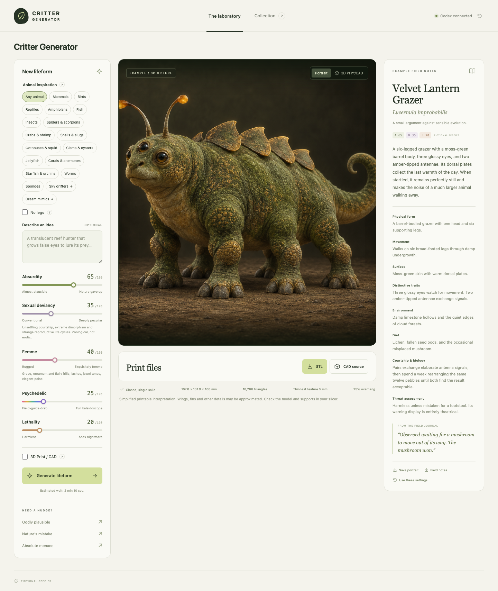
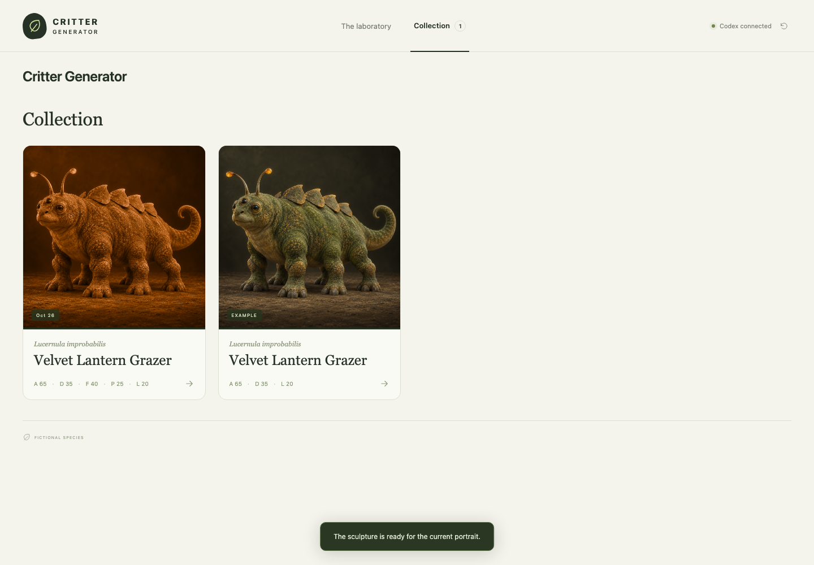
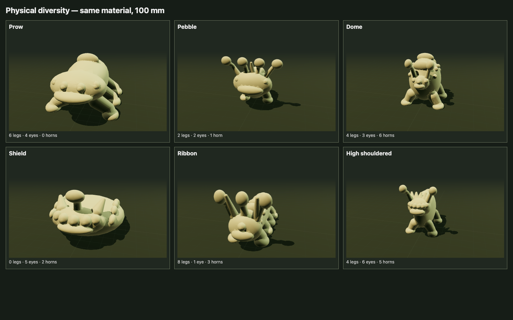

# Critter Generator

A locally hosted speculative-animal studio: wildlife images in their environments, English and
invented Latin names, field notes, animal inspiration chips, five personality sliders and optional CAD.

## Screenshots

| Creature studio | Saved collection |
|---|---|
|  |  |

Both views show the bundled fictional example specimen.



These six physical plans use the same sculpture material, so their differences come from geometry.

## Run

```sh
git clone https://github.com/JakeIwen/critter-generator.git
cd critter-generator
npm ci
npm start
```

Open **http://127.0.0.1:4329**. Node 22.13+ and the installed `codex` CLI are required.
`npm start` builds the frontend and runs the server in the foreground. Keep that Terminal open.
To stop the current app instance from a second Terminal:

```sh
cd /path/to/critter-generator
npm run stop
```

The app reuses your local Codex ChatGPT login.
It does not use or copy an API key. Generation uses the account's Codex allowance and requires internet.
Saved specimens, artwork, and models remain available offline. Check sign-in with:

```sh
codex --version
codex login status
```

If signed out, run `codex login`, complete its sign-in instructions, then click the connection indicator.
The app was verified with CLI 0.154.0. It discovers available models, preferring `gpt-6-astra` when
available and otherwise the account's returned default. No global Codex configuration is changed.

## Use

1. Leave **Any animal** selected or choose a pool of animal inspiration chips. Each generation draws
   one to three of those groups. **No legs** requires a legless animal; fins, wings and tentacles remain possible.
2. Optionally describe an idea or choose a preset.
3. Adjust **Absurdity**, **Sexual deviancy**, **Femme**, **Psychedelic**, and **Lethality** from 0–100.
   High values invite radical anatomy, uncanny symbioses, predatory mimicry and unsettling life cycles.
   Sexual deviancy covers clinical, non-erotic reproductive biology, including extreme dimorphism,
   brood parasitism and sexual cannibalism.
   Femme is grace and ornament (frills, lashes, jewel tones, poise), never sexualized. Psychedelic is
   fluorescent color, hypnotic patterning and dreamlike behavior; at 60+ the portrait drops the muted
   natural-history palette. The sliders are defined once in `shared/sliders.mjs`. Older saved specimens
   show only the sliders they were made with.
4. **3D Print / CAD** starts off for maximum biological freedom. Enable it to also make a simplified
   sculpture; then choose its total height (60–500 mm) and optional baseplate. Click **Generate lifeform**.
5. Codex writes structured biology and field notes, then its image-generation tool depicts the animal
   inside its habitat. Printing is skipped entirely when disabled. The loader estimates 130 seconds,
   shows elapsed and remaining time, and keeps waiting if generation takes longer.
6. Download the portrait and field notes JSON. Printable specimens also have the **3D Print/CAD** tab,
   rotatable preview, **STL** and editable **OpenSCAD CAD source**.
7. Open **Collection** to revisit saved animals. **Use these settings** restores its prompt, chips,
   legless choice, sliders and print options for a new variation. Older saved recipes retain print mode.

One generation runs at a time. Closing/reloading the page does not cancel it. Cancel explicitly
with the progress card. If the image step fails, the completed notes and any model remain saved;
**Retry portrait** retries only the artwork. Interrupted jobs are recorded after server restart.

The 16 real animal groups span familiar vertebrates and distinct invertebrate forms, with two
explicitly fictional bonuses. They deliberately mix taxonomic ranks for readable choices; see
[Animal inspiration groups](docs/animal-inspiration.md) for the catalog and biological sources.
Each generation samples inspirations, an anatomical challenge, camera viewpoint and ecological
encounter. Portrait prompts include the actual habitat, depth, contact and foreground occlusion;
they do not require a centered full-body studio pose. Recent history discourages repeated choices.
The choices and seed are saved in `variation`, so portrait retries keep the organism and scene direction.

Unrestricted animals use the structured `biology` description without the CAD body's dimensions or
appendage limits. When printing is enabled, a separate numeric anatomy samples one of six silhouette
families plus proportions, stance and ornament. Empty-prompt print generations keep those CAD traits;
explicit text can override them. Wings, fins, tentacles and other biological details can remain in the
artwork even when the simplified sculpt cannot reproduce them.

## Local database and files

**`.local/critters.sqlite` is the authoritative database.** SQLite uses WAL mode.
The `specimens` table stores each animal's names, prose, biology, optional CAD anatomy, settings, print
measurements, timestamps, and portrait state. `jobs` records generation progress and terminal status.
The first run includes a clearly labeled example sculpture. Generated specimens and artwork
stay local and are not included in the repository.

Assets are stored by specimen ID in `.local/specimens/<id>/`:

- `portrait.png`: actual generated artwork, if completed
- `model.stl`: binary triangle mesh in millimeters
- `model.scad`: editable constructive-solid-geometry source
- `mesh.json`: the same mesh used by the browser preview
- `record.json`: a human-readable metadata snapshot; the database remains authoritative

Image-only records have `anatomy: null` and `print: null`; STL, SCAD and mesh files are absent and their
download routes return 404. Older records without `biology` remain supported.

Everything under `.local/` is ignored by Git. No OpenAI account credentials are stored there.
The temporary `server.json` includes an instance-specific token used only by the local stop command.
The app imports any earlier file-based specimen records without replacing records already in SQLite.

Git also ignores environment files (except a placeholder-only `.env.example`), local credential
files, private keys, logs, database copies, backups, and agent notes. Keep credentials outside
the repository and review staged files before publishing; ignore rules do not inspect file contents.

For a complete backup, stop the app and copy **all** of `.local/`, not just the SQLite file:

```sh
cd /path/to/critter-generator
npm run stop
tar -czf "../critter-generator-backup-$(date +%Y%m%d-%H%M%S).tar.gz" .local
npm start
```

## Hosting behind Cloudflare Access

The server still binds only `127.0.0.1`. To serve it through a Cloudflare Tunnel, set:

- `PUBLIC_ORIGIN`: the public URL, e.g. `https://critter.lionfeather.dev`
- `ACCESS_TEAM_DOMAIN`: e.g. `<team>.cloudflareaccess.com`
- `ACCESS_AUD`: the audience tag of the Access application that guards `/auth/email`
- `CRITTER_PASSCODE` (optional): a shared passcode that also signs visitors in
- `CRITTER_DATA_DIR` (optional): data directory instead of `.local/`

Requests for the public host need a session cookie, which `/auth` issues in one of two ways:

- **Passcode:** the form at `/auth` checks `CRITTER_PASSCODE`. Ten wrong tries from one address
  (or 100 overall) in 15 minutes lock the form for 15 minutes. Changing the passcode signs out
  everyone who used it.
- **Email:** `/auth/email` is the only path Cloudflare Access guards, with its emailed one-time
  code. The server checks the `Cf-Access-Jwt-Assertion` signature against the team's published
  keys, plus issuer, audience, and expiry, before issuing the session.

Sessions last 7 days and are signed with a key kept in the data directory (`session-secret`).
Access must bypass the rest of the host; otherwise the passcode can never be reached. Localhost
requests work as before. Everyone signed in shares one collection and the host's Codex login.
The lionfeather.dev deployment lives in the `lionfeather-edge` repository (`apps/critter/`).

From this checkout, deploy an update with:

```sh
npm run deploy
```

This runs the complete isolated check suite, then calls the existing deployer in the sibling
`../lionfeather-edge` checkout with this checkout as its source. Set `LIONFEATHER_EDGE_DIR` if the
hosting repo lives elsewhere. The deployer copies the working tree, installs dependencies and builds
on the server, restarts `critter.service`, and checks its status endpoint. It excludes local data,
credentials and dependencies from the transfer; server specimens remain in `/var/lib/critter/data`.
Review uncommitted changes before deploying because they are included.

## 3D printing

The artwork follows the full biological description. **The optional sculpture is a simplified
interpretation, not a reconstruction of the image.** The CAD model uses rounded body parts, legs, a single
head, eyes, horns, antennae, a tail and dorsal plates; it cannot reproduce every animal structure.

The server unions the actual surfaces with Manifold, verifies a single closed boundary, scales to the
requested height, and optionally includes a flat display base with the creature. The browser previews that exact
STL geometry. STL has no intrinsic unit metadata; import using **millimeters**.
The sculpture has one material; STL does not include portrait colors or textures.

New models follow FDM conventions for a sturdy figurine (`PRINT_RULES` in `server/geometry.mjs`),
enforced in printed millimeters so they hold at every height:

- No horn, antenna or tail segment thinner than 3 mm. The print scale is solved first, then thin
  features are thickened to suit it.
- When enabled, a base slab at least 3 mm thick, with a 0.8 mm bottom chamfer against first-layer squish.
- Tails of 10+ relative units sweep down onto a small pad, rather than cantilevering.
  The base becomes the hull of its disc and the pad, so the footprint stays compact.
- The model info reports the thinnest feature, base thickness, the share of surface that overhangs
  more than 45° (support needed), and whether the center of mass sits over the middle of the base.

Printable generations vary their body and head silhouettes while retaining sturdy legs. The print schema caps belly clearance at six
relative units, and the CAD builder additionally caps it at one quarter of the torso's vertical
semi-axis. Leg shafts grow with body width and use broad joints and feet. The boundary-case tests
check a nominal leg shaft diameter of at least 5 mm, including 60 mm-tall sculptures. These are
geometric design constraints, not a material-strength guarantee. Older saved models and portraits
remain as generated; the sturdier recipe applies when creating new model files. The bundled
example's model is regenerated at startup whenever the design version changes.

Uncheck **Include baseplate** to export the creature alone; the exported model is grounded at Z=0.
The chosen height includes the baseplate when enabled. Existing saved models keep their original files.

Open the STL in your preferred slicer. Print upright with the baseplate or feet on the bed and tree or
organic supports for the belly, chin and eyes. Check those areas in layer preview. Geometry has been validated;
no physical print or printer-specific slicing has been performed. Material, nozzle size, support
settings, and print orientation still determine physical results. This app does not emit G-code.

Open `model.scad` in OpenSCAD to modify the primitives or `target_height_mm`. The CAD source uses
the same faceted sphere geometry, primitive recipe, and bed-contact clipping as the exported STL.

## Development and verification

```sh
cd /path/to/critter-generator
npm run check
npm audit
```

`npm run check` runs the unit tests, a scratch production build, and HTTP/binary-download
verification against a self-started server with temporary data. It does not use `.local`, Codex
credentials, live generation, or the normal port. `npm run verify:http` remains available when
checking an already running instance explicitly.

For frontend hot reload, keep `npm run serve` in one Terminal and `npm run dev` in another.
The development frontend at http://127.0.0.1:5173 proxies the backend at port 4329.
`PORT=4330 npm start` changes the production port (adjust the development proxy if using hot reload).

Tests verify STL edge closure and winding after binary serialization, requested dimensions,
extreme anatomy combinations, 120 seeded anatomy plans and 48 sampled solid exports, SQLite persistence/migration, malformed inputs, and Codex event
ownership/error handling. The HTTP check verifies actual asset downloads and local request boundaries.
An isolated Codex protocol fixture checks both print and image-only generation, persisted biology,
absent CAD assets, failed-portrait recovery and stable scene choices without contacting a model or reading credentials.
Live browser verification covered generation, interruption, collection navigation, artwork loading,
3D rendering, responsive width at 390 px, and restart persistence.

### Implementation

- `server/codex.mjs`: the CLI's stdio app-server protocol, model discovery, constrained JSON,
  native image generation, cancellation, and timeout handling. Only app-created ephemeral threads
  are used. Shell, MCP connectors, browsing, and filesystem modification tools are disabled.
- `shared/sliders.mjs`: the personality sliders (ids, labels, defaults), shared by server and browser.
- `shared/specimen.mjs`: input/anatomy validation, output schema, and generation prompts.
- `server/geometry.mjs`: shared solid/SCAD recipe and binary STL writer; built in a worker thread.
- `server/store.mjs`: SQLite metadata and asset persistence.
- `server/index.mjs`: loopback-only Express server and generation lifecycle.
- `server/access.mjs`: Cloudflare Access token verification for optional public hosting.
- `server/login.mjs`: public-host sign-in (passcode or Access email), session cookies, and lockout.
- `src/`: frontend and Three.js viewer, bundled locally with Vite.

`server/index.mjs` is the stable deployed process entry. It composes the Codex,
SQLite, geometry and authentication adapters in `server/`; schemas and prompt
rules shared with the browser remain in `shared/`. The external check, HTTP
verification and stop commands are listed in the Contracts table in `AGENTS.md`.
- `src/main.js`: frontend bootstrap; `src/studio.js` owns the laboratory, collection, specimen,
  and generation-job interactions; `src/viewer.js` owns the Three.js preview.

The app follows the [official Codex app-server protocol](https://developers.openai.com/codex/app-server/),
uses [Manifold](https://manifoldcad.org/docs/jsuser/classes/Manifold.html) for solid geometry, and
[Three.js OrbitControls](https://threejs.org/docs/pages/OrbitControls.html) for the print preview.
The installed CLI's generated protocol types were also inspected because the app-server evolves.
